<div align="center">



<a href="https://www.linkedin.com/in/mrashrhodes/"></a>


</div>

## `01` // PROFILE

```text
NAME ........... Ash Rhodes
CLASS .......... Builder, AI-assisted
SPECIALTY ...... Native macOS utilities
BASE ........... Europe · CET/CEST
STATUS ......... Open to remote work
```

I'm not a software engineer by trade. I just like building with AI, and I build apps I like and want to use.

Everything below started the same way: I wanted it, it didn't exist the way I wanted, so I built it.

## `02` // FIELD KIT

<table>
  <tr>
    <td width="33%" valign="top">
      <a href="https://mrashrhodes.github.io/glint/"></a>
      <h3><a href="https://github.com/MrAshRhodes/glint">GLINT</a></h3>
      <a href="https://github.com/MrAshRhodes/glint/releases/latest"></a><br />
      Screenshot beautifier: capture, backgrounds, annotations, auto-redact and a CLI. Your images never leave your Mac.<br />
      <sub><code>Swift</code> <code>SwiftUI</code> <code>AppKit</code> <code>Sparkle</code></sub><br />
      <sub><a href="https://mrashrhodes.github.io/glint/">Site</a> · <a href="https://github.com/MrAshRhodes/glint/releases/latest">Download</a></sub>
    </td>
    <td width="33%" valign="top">
      <a href="https://mrashrhodes.github.io/whisker/"></a>
      <h3><a href="https://github.com/MrAshRhodes/whisker">WHISKER</a></h3>
      <a href="https://github.com/MrAshRhodes/whisker/releases/latest"></a><br />
      Mouse and trackball customiser: button remapping, per-app profiles, pointer and scroll tuning, all from the menu bar.<br />
      <sub><code>Swift</code> <code>SwiftUI</code> <code>Event taps</code></sub><br />
      <sub><a href="https://mrashrhodes.github.io/whisker/">Site</a> · <a href="https://github.com/MrAshRhodes/whisker/releases/latest">Download</a></sub>
    </td>
    <td width="33%" valign="top">
      <a href="https://mrashrhodes.github.io/barback/"></a>
      <h3><a href="https://github.com/MrAshRhodes/barback">BARBACK</a></h3>
      <a href="https://github.com/MrAshRhodes/barback/releases/latest"></a><br />
      A fast, minimal menu bar icon hider. One chevron, one separator, no Screen Recording permission needed.<br />
      <sub><code>Swift</code> <code>SwiftUI</code> <code>AppKit</code></sub><br />
      <sub><a href="https://mrashrhodes.github.io/barback/">Site</a> · <a href="https://github.com/MrAshRhodes/barback/releases/latest">Download</a></sub>
    </td>
  </tr>
</table>

All three are open source, notarised by Apple, local-first, with no accounts and no telemetry.

```sh
brew tap MrAshRhodes/tap
brew install --cask glint barback whisker
```

Also in the field: **[mermaidtopng.com](https://www.mermaidtopng.com)**, a browser-local Mermaid to PNG, JPEG and SVG converter.

## `03` // LOADOUT


## `04` // PROTOCOL

- **Build what I'll use.** Every tool here fixes something that annoyed me. I'm user zero.
- **AI writes, I direct.** I decide what each app should do, steer the agents and test everything on my own Mac.
- **Finish it properly.** Tests, signed releases, docs and a Homebrew install, so anyone else can try it too.
- **Privacy by default.** Local-first, no accounts, no telemetry.
- **Honest docs.** My READMEs say what's verified and what isn't. Check Whisker's.

## `05` // CURRENT MISSION

```text
[ACTIVE]  Building and using Glint, Whisker and Barback
[SEEKING] Remote work where building useful tools with AI is the job
```

## `06` // TELEMETRY

<div align="center">


<picture>
  <source media="(prefers-color-scheme: dark)" srcset="https://raw.githubusercontent.com/MrAshRhodes/MrAshRhodes/output/github-snake-dark.svg" />
  <source media="(prefers-color-scheme: light)" srcset="https://raw.githubusercontent.com/MrAshRhodes/MrAshRhodes/output/github-snake.svg" />
  
</picture>

</div>

## `07` // OPEN CHANNEL

The fastest way to reach me is [LinkedIn](https://www.linkedin.com/in/mrashrhodes/). If you're hiring remotely and any of this looks useful, send a message.


